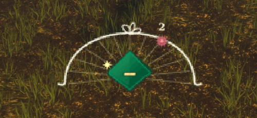
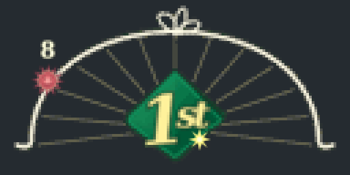
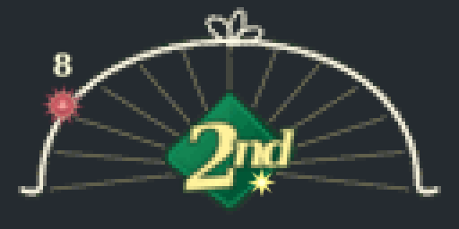
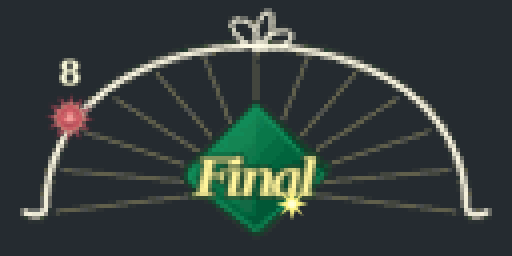
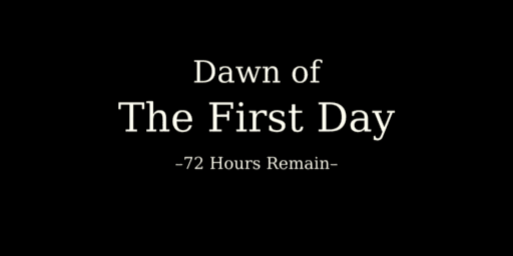

# Termina Clock

A just-for-fun Majora's Mask–style countdown to the end of the WoW Forever Beta.

The clock follows your computer's local time: dawn is **6:00 a.m.**, and dusk is **6:00 p.m.** The diamond shows `1st`, `2nd`, and `Final` on the last three local days leading into the deadline. The sun or moon marks the local hour; the small orbiting light shows progress through that hour. Everyone's countdown ends at the same moment, so the final day can be shorter than 24 hours.

Warning bells lead into local dawn and dusk. Before the second and final dawns, the render area becomes smaller in four steps, with black borders moving inward. **During combat, the render area does not scale down, but the outer black bars still move inward. Once you leave combat, the render area starts shrinking.** The camera and UI stay unchanged. The previous render area returns as the dawn animation starts.

At dawn, a black screen announces the day and actual rounded hours remaining. Other game audio is muted during the dawn screen and restored afterward. **The dawn cutscene does not pause gameplay: you can still be attacked and interact with the world while it covers the screen.** Dusk shows a translucent night title without muting game audio. Bells become more frequent during the final six hours.

The clock ends at the **estimated stress-test finish: October 21, 2026, at 5:00 p.m. PDT** (October 22 at 00:00 UTC). That's a guess of three hours after the announced 2:00 p.m. PDT start. [Blizzard says the test lasts a few hours](https://us.forums.blizzard.com/en/wow/t/wow-forever-stress-test-october-21/2383617), but hasn't announced an exact end time. Custom deadlines stay unchanged.

The three day labels, shown here as generated artwork previews:

| First day | Second day | Final day |
| --- | --- | --- |
|  |  |  |

The black dawn transition announces the day and hours remaining for your time zone. This is a generated preview of its title screen:

Drag the clock to move it, and hover over it to see the countdown and target time. Use `/termina` for commands.

- `/termina test dayend` previews the bells and dawn sequence without changing the deadline.
- `/termina test 1st`, `/termina test 2nd`, and `/termina test final` preview the day labels.
- `/termina dawn first`, `/termina dawn second`, and `/termina dawn final` preview the black dawn screens.
- `/termina dusk first`, `/termina dusk second`, and `/termina dusk final` preview the evening titles.
- `/termina test stop` cancels a preview and restores the view and audio.
- `/termina sound`, `/termina screen`, and `/termina transitions` toggle the effects.
